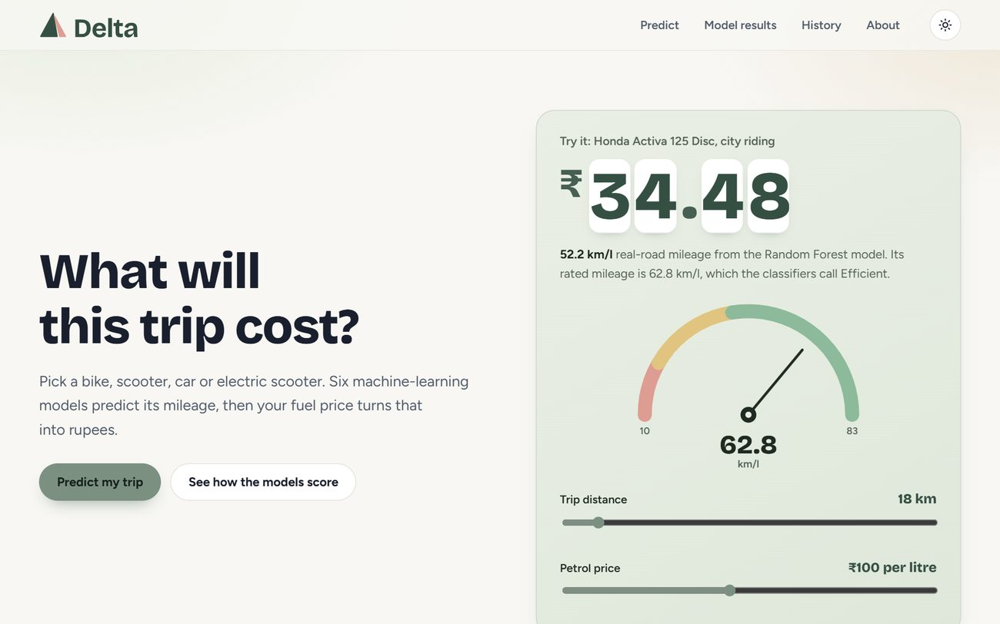
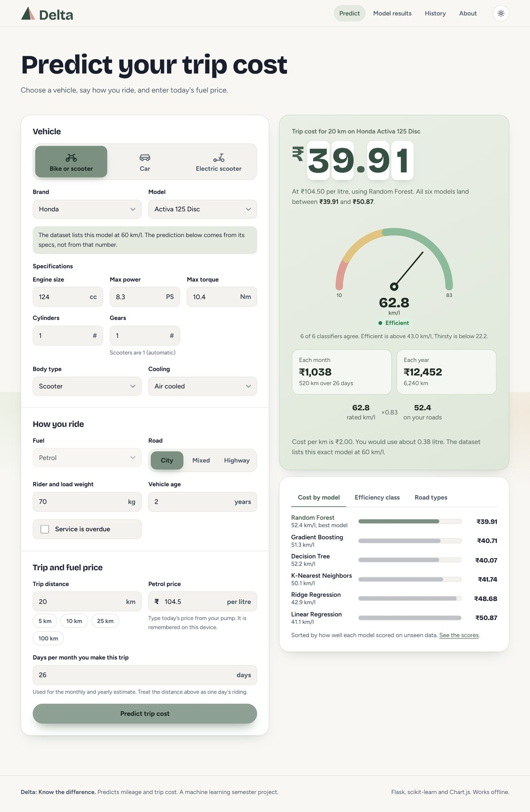
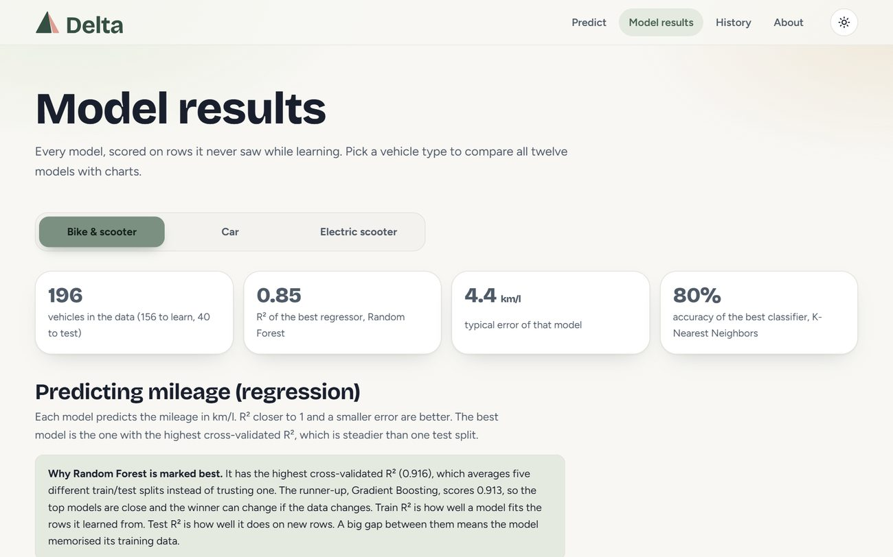
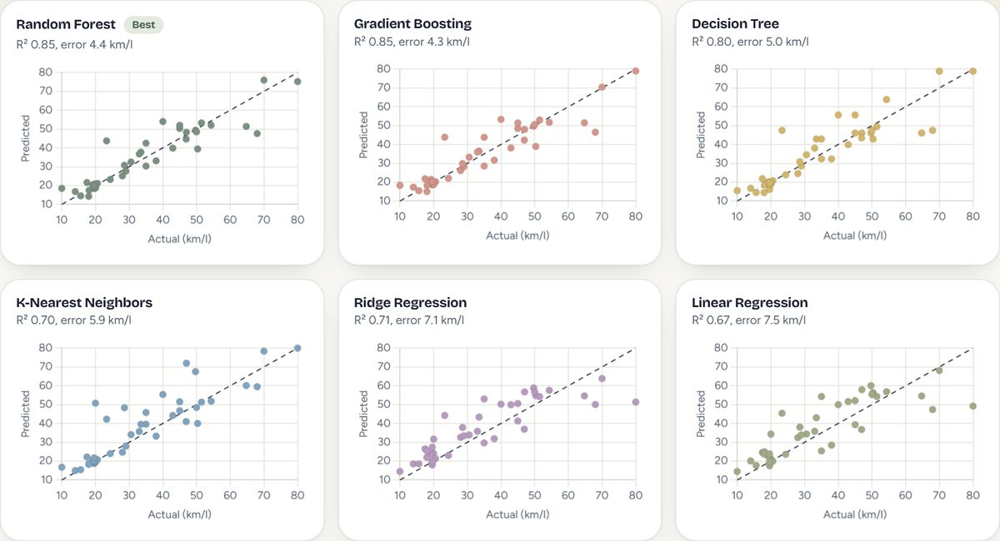

<p align="center">
  <picture>
    <source media="(prefers-color-scheme: dark)" srcset="public/static/brand/delta-lockup-tagline-dark.svg">
    
  </picture>
</p>

<p align="center">
  Predict the mileage of a bike, scooter, car or electric scooter, and see what your trip will really cost.
</p>

<p align="center">
  
</p>

## What it does

The brochure tells you one mileage. The road gives you another. Fuel prices change the final bill. **Delta** (Δ, the symbol for difference) puts these differences side by side before you start a journey.

You pick a vehicle, say how you ride, and type today's fuel price. Twelve machine learning models per vehicle type predict the mileage, and the site turns it into rupees: the cost of the trip, of a month and of a year. Every model's answer is shown, so you can see where they agree and where they differ.

- **Real data.** Trained on real bike, car and electric scooter datasets, not on made-up numbers.
- **12 models per vehicle type.** 6 regression models predict the mileage. 6 classification models rate it Thirsty, Balanced or Efficient.
- **Brand and model list.** Choose a brand and model and the specifications fill in. Or type your own.
- **You enter the fuel price.** Petrol, diesel, CNG or electricity. Nothing is stored in the code, so the cost is always as current as the price you type.
- **Real-road estimate.** Rated mileage is adjusted for road type, load, vehicle age, air conditioning and overdue service.
- **Every model's result.** Train and test scores, error charts, actual-vs-predicted plots, input importance, and a confusion matrix for each classifier.
- **Soft sage theme.** Light and dark mode, rolling odometer, mileage gauge, works on a phone and offline.

## Screenshots

<p align="center">
  
</p>

<p align="center">
  
  &nbsp;
  
</p>

## Results

Scores are on rows the models never saw while learning. The best model is the one with the highest cross-validated score.

| Vehicle type | Rows | Best regressor | Test R² | CV R² | Typical error | Best classifier | Test accuracy |
|---|---:|---|---:|---:|---:|---|---:|
| Bike and scooter | 196 | Random Forest | 0.849 | 0.916 | 4.44 km/l | K-Nearest Neighbors | 80.0% |
| Car | 391 | Random Forest | 0.854 | 0.756 | 0.99 km/l | Random Forest | 86.1% |
| Electric scooter | 42 | Gradient Boosting | 0.804 | 0.707 | 10.16 km/kWh | Random Forest | 55.6% |

The models score higher on their training rows than on new rows, so they overfit a little because the data is small. The Model results page shows train and test scores side by side for every model.

## How a trip cost is worked out

```
Real-road mileage = predicted rated mileage x real-road factor
Trip cost         = distance / real-road mileage x fuel price
Monthly cost      = trip cost x days per month
```

The real-road factors (city x0.88, highway x1.05, extra weight, age, overdue service, air conditioning, and diesel x1.25 / CNG x1.35 for cars) are documented assumptions, not learned from data. They live in `features.py` and are easy to change.

## Data

| File (in `data/raw`) | Used for |
|---|---|
| `Bike_Features.csv` | Bikes and scooters: listed mileage, cc, power, torque, gears, cooling. Many rows have shifted columns, so `build_dataset.py` finds each value by pattern. |
| `mpg_raw.csv` (same data as `auto-mpg.csv`) | Cars. Miles per gallon is converted to km/l. |
| `Electric scooter - dataset.xlsx` | Electric scooters. Efficiency is range divided by battery kWh. |

Two other files were looked at and **left out on purpose**: `bike_sales_india.csv` looks randomly generated (the same bike model appears with engines from 109 to 996 cc and with petrol, hybrid and electric fuel), and `CAR DETAILS FROM CAR DEKHO.csv` has prices but no mileage or engine data.

## Run it

Needs Python 3.9 or newer.

```bash
git clone https://github.com/Suro026/Student-Perfomance-Prediction.git
cd Student-Perfomance-Prediction
pip install -r requirements.txt
python app.py
```

On Windows use `py -m pip install -r requirements.txt` and `py app.py`. Then open http://127.0.0.1:5000.

The 36 trained models are included in `models/`, so it starts instantly. To rebuild the data and retrain: `python build_dataset.py`, then `python train.py`.

## Deploy on Vercel

1. Import the repository in Vercel. The preset is **Flask** and the root directory is `./`.
2. Add an environment variable `SECRET_KEY` (any long random text).
3. Deploy.

The entry point is `app.py`. `.python-version` selects Python 3.13 and `requirements.txt` pins the versions the models were trained with. Static files are in `public/static`, which Vercel serves from its CDN. The project folder is read-only on Vercel, so the history database is written to `/tmp` and resets when the serverless instance is recycled.

## Project structure

```
app.py             Flask app, JSON API, SQLite history, validation, security headers
features.py        Vehicle types, feature lists and the real-road factors
build_dataset.py   Cleans data/raw/* into data/bikes.csv, cars.csv, escoot.csv
train.py           Trains and compares the 36 models, writes models/metrics.json
templates/         HTML pages
public/static/     CSS, JS, logo, fonts and Chart.js (works offline)
data/              Raw files and the three cleaned tables
models/            Saved models and metrics.json
docs/screenshots/  Images used in this README
```

## Limits

- The car data is the Auto-MPG set of 1970 to 1982 cars. Modern cars usually go further on a litre than the rated figure shown.
- Bike mileage is the listed figure, not measured on a road.
- The electric scooter set has only 42 models and many are kick scooters, so those predictions are rough.
- Diesel and CNG for cars are estimated factors, because the car data is petrol only.
- There is no live fuel price, map or traffic data. You type the price.

## Built with

Python, Flask, scikit-learn, pandas, Chart.js, Bricolage Grotesque and Figtree. Colours adapted from the Sage Garden theme on [21st.dev](https://21st.dev/community/themes/sage-garden).

A machine learning semester project by **Surajit Sadhukhan**.
